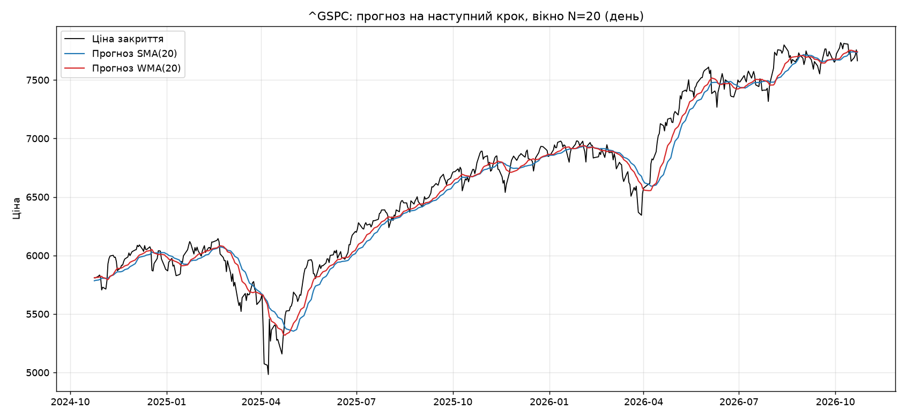
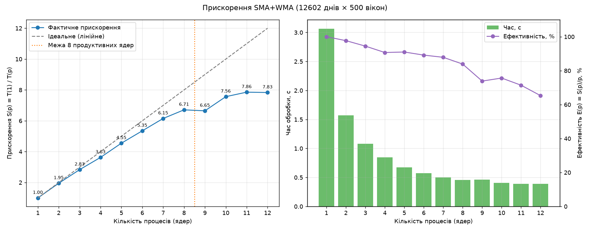
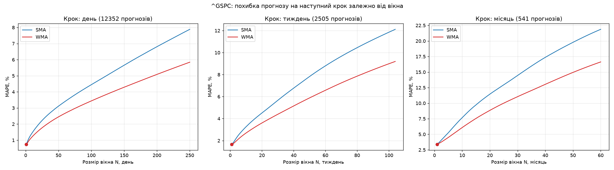

# Паралельне рухоме середнє та прогноз котирувань

Паралельний розрахунок простого (SMA) і зваженого (WMA) рухомого середнього за вікном довжиною N на 50-річній історії індексу S&P 500, прогноз на наступний крок, оцінка похибки та вимірювання прискорення на 1–N ядрах.

## Що робить програма

1. Завантажує денні ціни закриття з Yahoo Finance (за замовчуванням `^GSPC`, 50 років) і кешує їх у `data/`.
2. Переходить до потрібного кроку: день, тиждень або місяць.
3. Паралельно рахує SMA і WMA за вікном N і звіряє результат з еталоном pandas/numpy.
4. Робить прогноз на наступний крок і рахує похибки MAE, RMSE, MAPE.
5. Перебирає розміри вікна, щоб знайти найточніший.
6. Заміряє час на 1…N процесах і будує графік прискорення.

## Методи

Прогноз на наступний крок дорівнює значенню середнього на поточному кроці: $\hat y_{t+1} = MA_N(t)$.

$$SMA_N(t) = \frac{1}{N}\sum_{k=0}^{N-1} y_{t-k} \qquad WMA_N(t) = \frac{\sum_{k=0}^{N-1} (N-k)\, y_{t-k}}{N(N+1)/2}$$

У WMA ваги лінійні: найновіша ціна має вагу N, найстаріша — 1.

**Розпаралелювання за даними.** Індекси ряду діляться на блоки, кожен з яких обробляє окремий процес (`ProcessPoolExecutor`). Для точки t потрібні лише N попередніх цін, тому блоки незалежні й синхронізація не потрібна. Ряд передається кожному процесу один раз через ініціалізатор пулу. Під час перебору вікон процеси повертають лише часткові суми похибок, які потім додаються. Багатопотоковість BLAS вимкнена, щоб numpy сам не займав додаткові ядра і не спотворював заміри.

## Встановлення та запуск

```bash
python3 -m venv .venv
.venv/bin/pip install -r requirements.txt
.venv/bin/python main.py --timeframe day --window 20
```

| Параметр | За замовчуванням | Опис |
|---|---|---|
| `--ticker` | `^GSPC` | тікер Yahoo Finance |
| `--years` | `50` | глибина історії (10–50) |
| `--timeframe` | `day` | одиниця вікна: `day`, `week`, `month` |
| `--window` | `20` | довжина вікна N |
| `--max-workers` | кількість ядер | максимум процесів у бенчмарку |
| `--bench-windows` | `500` | у бенчмарку рахуються вікна 1…K |
| `--repeats` | `3` | повторів заміру (береться найкращий) |

Результати зберігаються в `results/`: графіки, `window_errors.csv`, `benchmark.csv` і `summary.json`.

## Результати

Дані: S&P 500, 12 602 торгові дні (1976-10-25 — 2026-10-22). Машина: 12 ядер (8 продуктивних і 4 енергоефективні).

### Прогноз (денний крок, N=20)

| Метод | Прогноз на 23.10.2026 | MAE | RMSE | MAPE |
|---|---|---|---|---|
| SMA | 7733.46 | 28.85 | 54.67 | 1.98% |
| WMA | 7734.87 | 23.05 | 44.15 | 1.59% |



### Прискорення

Навантаження: SMA і WMA для вікон 1…500 на всьому денному ряді.

| Процесів | 1 | 2 | 4 | 8 | 12 |
|---|---|---|---|---|---|
| Час, с | 3.07 | 1.57 | 0.85 | 0.46 | 0.39 |
| Прискорення | ×1.0 | ×1.95 | ×3.6 | ×6.7 | ×7.8 |



До 8 процесів прискорення майже лінійне. Далі зростання сповільнюється, бо підключаються повільніші енергоефективні ядра, а також додаються витрати на обмін даними між процесами.

### Який розмір вікна кращий

| Крок | Без згладжування (N=1) | SMA, N=2 | WMA, N=2 |
|---|---|---|---|
| день | 0.74% | 0.84% | 0.79% |
| тиждень | 1.66% | 1.82% | 1.73% |
| місяць | 3.38% | 3.84% | 3.63% |



- Похибка зростає разом з довжиною вікна, тому для прогнозу на один крок найкраще найменше вікно, N=2.
- WMA за будь-якого N точніший за SMA, бо швидше реагує на зміни.
- Жодне згладжування не обіграло прогноз «як останнє значення» (N=1). Ціни індексу поводяться близько до випадкового блукання, тож довге вікно лише збільшує запізнення. Великі вікна корисні для пошуку тренду, а не для точкового прогнозу.

## Структура

```
main.py                 запуск усіх етапів, CLI
pma/data.py             завантаження й зміна кроку (день/тиждень/місяць)
pma/moving_average.py   паралельні SMA/WMA, перебір вікон, бенчмарк
pma/plots.py            графіки
```
